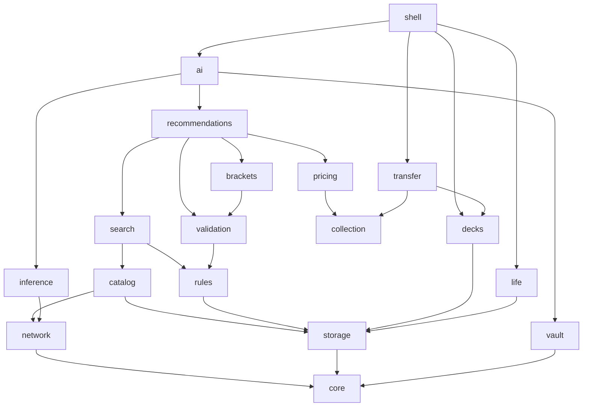

# COMPONENTS: Gate 2 dependency inventory

Dependencies are allowed conceptual interfaces, not authorization to edit another component's files. Domain entities/ports remain pure Dart. Each implementation gets its own Gate3 ARCHITECT with exclusive owned paths, public signatures and test plan. Shell composition injects adapters; domain code never imports the composition root.

| Component | Purpose | Allowed dependency components |
|---|---|---|
| core | Pure entities, repository port contracts, typed errors, clocks/IDs | none |
| network | Shared HTTP/SSE, origin-bound auth and rate limiting | core |
| vault | Native encrypted secrets bridge | core |
| storage | SQLite executor, migration/transaction infrastructure | core |
| catalog | Source ingestion, generation and image jobs | core, network, storage |
| rules | Full offline corpus and glossary parser | core, network, storage |
| search | Typed local query/FTS and online action | core, catalog, rules, storage |
| decks | User editing, boards, versions and playtest domain | core, storage |
| collection | Owned-lot accounting and entry editing | core, storage |
| pricing | Quotes, fiat conversion and acquisition allocation | core, catalog, collection, network, storage |
| validation | All-format deterministic checks and unknown intent | core, catalog, rules |
| brackets | Reviewed bracket rules/membership/combos and assessment | core, catalog, rules, validation, storage, network |
| recommendations | Offline explanation and constrained upgrade plans | core, search, pricing, validation, brackets |
| transfer | Text/CSV/native backup and import/restore preview | core, catalog, decks, collection, storage |
| life | Offline event reducer, seat/counters/timers/results | core, rules, storage |
| inference | On-device runtime/model manager behind interface | core, network, storage |
| ai | Provider codecs/context/tools/reply validation/history | core, search, validation, pricing, recommendations, vault, network, inference, storage |
| settings | Preferences, consent and attribution metadata | core, storage, vault |
| links | Supplied URI selection, safe templates and browser-opening boundary | core, catalog |
| shell | Flutter navigation, presentation, adaptive UI, composition | core, catalog, rules, search, decks, collection, pricing, validation, brackets, recommendations, transfer, life, ai, inference, settings, links |

## DAG

An arrow A -> B means A may depend on B. This full adjacency list is the authoritative graph; Mermaid below is a readable projection, not a separate graph.

## Shared boundaries and gate constraints

Orchestrator owns build/dependency pins, DI/composition registry, navigation registry, schema registry, CI and shared configuration. Component writers request shared edits, never overlap. Root port/entity definitions finalized first; platform adapters implement ports, domain operations accept immutable snapshots. No reverse feature dependency from storage/network/core. Deck/collection identities are core snapshots, so life/AI do not import a deck UI to read them.

Gate3 verifies no cycles and zero owned-path overlap with interfaces merged before dependent parallel implementation. No actual worktree/push/build support inferred from this conceptual DAG. All background repository/inference calls accept cancellation; source refresh cannot invalidate an in-progress user transaction. Package sizes/versions and final maximum implementer concurrency are Gate3 decisions.
